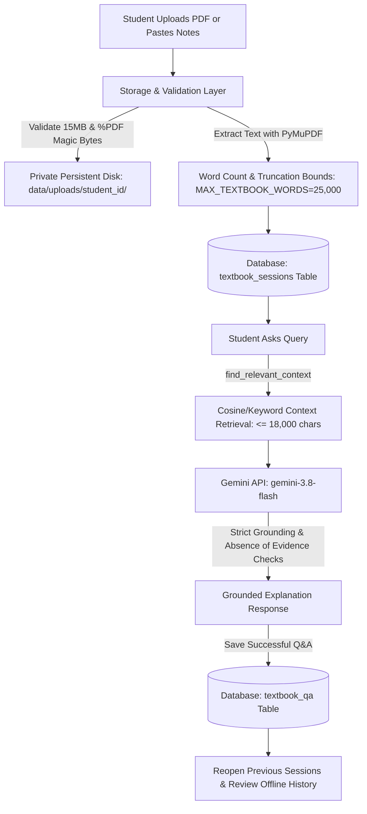

# Bloom — AI-Powered Personalised Learning Companion

Bloom is a pedagogical AI learning companion engineered to help students find learning gaps, retain conceptual knowledge through active spaced recall, analyse examination mistake patterns, and understand dense textbook literature with strictly grounded AI explanations.

Built with **Python**, **Streamlit**, **Gemini API** (`google-genai` SDK), **SQLite / PostgreSQL**, **Pandas**, **Plotly**, and **PyMuPDF**.

---

## 🏛️ System Architecture & Data Flow

### 1. High-Level System Architecture Diagram

```
+---------------------------------------------------------------------------------+
|                                 STUDENT / LEARNER                               |
+---------------------------------------+-----------------------------------------+
                                        |
                                        v
+---------------------------------------------------------------------------------+
|                       AUTHENTICATION & ACCESS CONTROL                           |
|  - OpenID Connect (OIDC / Google OAuth) via Streamlit Auth                      |
|  - Local profile session with deterministic owner ID hashing (local:<id>)       |
|  - Stable internal owner_id scoping (display name edits do NOT reset account)   |
+---------------------------------------+-----------------------------------------+
                                        | Authenticated Context (owner_id)
                                        v
+---------------------------------------------------------------------------------+
|                             STREAMLIT APPLICATION                               |
|  +--------------------+---------------------+--------------------+              |
|  | Overview           | Find My Gaps        | Marks Analysis     |              |
|  +--------------------+---------------------+--------------------+              |
|  | Recall & Revision  | Textbook Helper     | My Progress        |              |
|  +--------------------+---------------------+--------------------+              |
+-------------------+-----------------+-----------------------+-------------------+
                    |                 |                       |
                    v                 v                       v
      +-----------------------------+ | +------------------------------------+
      |    DATABASE (SQLite / PG)   | | |    PRIVATE PERSISTENT STORAGE      |
      |  - students (owner_id, name)| | |    (data/uploads/{student_id}/)    |
      |  - attempts, mastery        | | |  - Private textbook PDF files      |
      |  - test_sessions, reviews   | | |  - Magic-byte & size validation    |
      |  - textbook_sessions (text) | | |  - Strict owner directory scoping  |
      |  - textbook_qa (history)    | | +------------------------------------+
      +-----------------------------+ |
                    ^                 | Student question + relevant excerpts
                    |                 v
                    |   +---------------------------------------------+
                    |   |              GEMINI API SERVICE             |
                    |   |  - Model: gemini-3.8-flash (authoritative)  |
                    |   |  - Strict source grounding prompt bounds    |
                    |   |  - Absence of evidence detection            |
                    |   |  - Clear separation of external background  |
                    +---|  - Sanitized learner-facing error handling  |
     Successful answers +---------------------------------------------+
```

### 2. Textbook Grounding & Study Session Pipeline



---

## 💾 Storage Architecture: Dev vs. Production

Bloom employs a tiered storage model designed for privacy, concurrency, and persistence:

| Data Type | Development (Local) | Production (Cloud Hosted) | Purpose & Isolation |
| :--- | :--- | :--- | :--- |
| **Relational Student Data** | `bloom.db` (SQLite in WAL mode) | Managed PostgreSQL (`DATABASE_URL`) | Student accounts, diagnostic attempts, spaced reviews, test milestones, mastery matrix, and textbook session metadata. Scoped strictly by `owner_id`. |
| **Uploaded PDF Textbooks** | Local filesystem (`data/uploads/{student_id}/`) | Persistent Disk or Private Cloud Object Store (S3/GCS bucket) | Raw uploaded PDF documents. Never stored as unbounded BLOBs in the database; referenced via relative storage paths. Protected by `.gitignore`. |
| **Extracted Source Text** | SQLite `textbook_sessions.extracted_text` | PostgreSQL `textbook_sessions.extracted_text` | Retained in database so students can revisit past study sessions and ask questions even when offline or without re-uploading. |
| **Ephemeral State** | Streamlit `st.session_state` | Streamlit `st.session_state` | Temporary widget state, radio selections, active quiz progress, and client view toggles. Cleared on logout. |

### Database Persistence & Concurrency
- **WAL Mode (Write-Ahead Logging):** Configured via `PRAGMA journal_mode = WAL` in `core/db.py` to allow concurrent readers while a write is underway.
- **Busy Timeout:** `PRAGMA busy_timeout = 5000` prevents database locks during simultaneous practice submissions.
- **Online Zero-Downtime Backup:** `core/backup.py` uses SQLite's native `sqlite3.backup()` API to snapshot the database without locking concurrent active students.
- **Migration & Schema Upgrades:** `migrate_db()` in `core/db.py` non-destructively inspects schema columns and creates indexes (`idx_students_owner`, `idx_textbook_sessions_student`, `idx_textbook_qa_session`).

---

## 🔐 Identity, Authentication & Data Isolation

Bloom rejects display names as primary identifiers. Display names are editable profile fields, not database identities.

### 1. Authentication Options
- **Institutional OpenID Connect (OIDC / Google OAuth):** When configured in `.streamlit/secrets.toml` under `[auth]`, Bloom leverages Streamlit's native OIDC integration (`st.login`, `st.user`, `st.logout`) with verified Google credentials.
- **Local Profile Access:** For local development and offline environments, Bloom generates a deterministic, stable owner ID (`local:<hash>`) based on the learner's profile key or institutional email.

### 2. Multi-Student Data Isolation
- Every database query in `core/db.py` scopes operations strictly to the student's internal integer `student_id` which maps to the authenticated `owner_id`.
- Study sessions, uploaded files, Q&A records, test marks, and review schedules cannot be accessed, modified, or deleted by another student.
- Editing a display name calls `update_student_profile()`: it updates the name in-place without changing the primary key or erasing historical attempts.
- Legacy unattached `Learner` data is safely quarantined and can be claimed explicitly by an authenticated student.

---

## 🤖 Gemini AI Integration & Grounding Rules

Bloom integrates the Google Gemini API using the modern `google-genai` SDK (version 2.33.0).

- **Default Authoritative Model:** `gemini-3.8-flash`
- **Model Override:** An optional `GEMINI_MODEL` override in `.streamlit/secrets.toml` is respected.
- **Privacy & Learner Safety:** Internal model identifiers (`gemini-3.8-flash`), HTTP status codes (e.g., `429`, `504`), stack traces, and raw JSON errors are never exposed to learners. The UI indicates simple, friendly statuses such as `AI-generated` or `Curated offline fallback`.
- **Textbook Source Grounding:**
  1. **Explicit Source Bounds:** The AI is instructed to explain strictly based on the extracted textbook excerpt.
  2. **Absence of Evidence:** If the source excerpt does not establish the fact, Gemini states explicitly: *"The provided source text does not contain sufficient information to answer this question."*
  3. **Separation of External Background:** Any supplementary pedagogical context outside the text is strictly separated under: `### 💡 General Educational Background (Outside Source Text)`.
  4. **Prompt Injection Resistance:** The grounding prompt instructs the model to ignore adversarial instructions embedded inside user-uploaded documents.

---

## 🚀 Setup & Local Execution

### Prerequisites
- Python 3.10+ (tested on Python 3.14.6)
- PowerShell (Windows) or Bash (macOS/Linux)

### Installation
```powershell
# 1. Clone repository and navigate to folder
cd C:\learning_agent

# 2. Create virtual environment
python -m venv .venv
.\.venv\Scripts\Activate.ps1

# 3. Install dependencies
pip install -r requirements.txt

# 4. Configure secrets
Copy-Item .streamlit\secrets.toml.example .streamlit\secrets.toml
```

### Configure Secrets (`.streamlit/secrets.toml`)
```toml
# Google Gemini API Key
GEMINI_API_KEY = "your-gemini-api-key-here"

# Authoritative Model (Defaults to gemini-3.8-flash if omitted)
GEMINI_MODEL = "gemini-3.8-flash"

# Optional: Institutional Google OpenID Connect (OIDC) Authentication
# [auth]
# redirect_uri = "http://localhost:8501/oauth2callback"
# cookie_secret = "generate-a-random-32-byte-hex-string"
# client_id = "your-google-oauth-client-id.apps.googleusercontent.com"
# client_secret = "your-google-oauth-client-secret"
# server_metadata_url = "https://accounts.google.com/.well-known/openid-configuration"
```

### Safe Diagnostic & Connection Check
Run the diagnostic script without revealing secrets or starting the web server:
```powershell
.\.venv\Scripts\python -m services.gemini_service
```

### Launch Application
```powershell
.\.venv\Scripts\streamlit run app.py
```

---

## 🧪 Comprehensive Testing & Verification

Bloom includes a rigorous automated test suite covering end-to-end workflows, database isolation, chart aggregation, textbook grounding, and AI failure resilience.

Run all tests:
```powershell
.\.venv\Scripts\pytest -v
```

### Verified Test Categories
1. **Daily Chart Aggregation:** Verifies calendar date grouping (`%b %d`), integer category axes, and empty states without solid blocks or fabricated dates.
2. **Textbook Grounding & Dual Source Isolation:** Verifies that distinct documents provide document-specific excerpts and that placeholder example questions are never automatically submitted.
3. **Model & Exception Sanitization:** Confirms model IDs, API keys, HTTP status codes, and tracebacks are never exposed on learner-facing screens.
4. **Authentication & Multi-User Isolation:** Verifies that two distinct accounts have isolated attempts, marks, study sessions, and private uploaded PDFs.
5. **Session Persistence & Deletion:** Verifies study sessions and Q&A history survive app restarts and that session deletion removes both DB records and stored PDF files.
6. **AI Resilience & Fallbacks:** Tests behavior under timeouts, quota limits, and offline mode.

---

## 📋 Viva Presentation Summary

1. **What is Bloom?** An AI-powered learning companion that bridges the gap between passive reading and active retention through grounded diagnostics, spaced review scheduling, error pattern analysis, and interactive textbook explanations.
2. **How is source grounding enforced?** Documents are parsed with PyMuPDF, truncated to 25,000 words, and searched for question-relevant context (<=18,000 characters). Gemini 3.8 Flash is prompted with strict source boundaries, required to state absence of evidence, and required to label any general background under a distinct heading.
3. **How is learner privacy guaranteed?** All database queries are owner-scoped. Display names are decoupled from account IDs. Uploaded PDFs are stored in private, unexposed directories (`data/uploads/{student_id}/`). Secrets are excluded from git.
4. **How does the system handle AI failures?** Offline topic-specific curated question banks serve as immediate fallbacks, clearly labeled as offline practice so learners are never misled.
